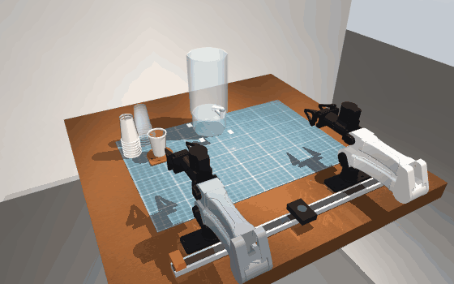

# Everest dual-YAM digital twin

A MuJoCo digital twin of a two-arm (I2RT YAM) water-cup station: pick a paper or plastic cup, hold it under a dry dispenser spout, let the second arm open the lever for a 7 s pour, and serve the cup into a coaster. Five levels of increasing uncertainty, all driven by one set of skills that only read what real motors would report (joint position, velocity, torque, gripper width and effort).



Project page: https://everest-dual-yam-twin.netlify.app

## What is in here

| Part | Where | What it does |
|---|---|---|
| Calibration | `sim_station/layout.py` | Every measured number: base poses, object poses per level, gripper map, force caps, speed limits, the real taught Level 1/2 waypoints |
| World | `scene.py`, `plant.py` | MuJoCo scene (hollow stave cups, nested stack, passive 360° lever with a lift hinge, funnel coaster), MIT-style PD control with gravity feed-forward, noisy sensors, contact referee |
| Sensing | `sensing.py` | Contact force from torque residuals: `F = -pinv(Jᵀ)(τ - τ_gravity - τ_friction)` |
| Motion | `kin.py`, `motion.py` | Strict mink IK, min-jerk synchronized trajectories, Cartesian lines |
| Skills | `skills*.py` | Side grasp with lateral admittance and chord-width depth servo, spout insertion, lever routine, coaster place, pecks, handle search, one-arm in-air cup flip |
| Levels | `levels.py` | Dependency graphs of skills on two arm lanes |
| Proofs | `proofs.py`, `evaluate.py`, `selftest.py` | Real-data replay, IK vs real poses, Monte Carlo with a failure histogram |
| Live twin | `station.py`, `server.py`, `static/index.html` | 40+ fps JPEG stream, view cube, timeline with scrub, telemetry, Monte Carlo, Dance Mode |
| Dance | `audio.py`, `dance.py` | Beat tracking of your own audio files and beat-locked choreography |
| Hardware seam | `sim_robot.py` | `SimYam` implements i2rt's `Robot` protocol so the same driver runs on the twin or on `get_yam_robot` |

## Run it

```bash
git clone https://github.com/Shaurya-Srivastav/everest-dual-yam-twin && cd everest-dual-yam-twin
git clone https://github.com/i2rt-robotics/i2rt third_party/i2rt     # arm and gripper models (or set I2RT_PATH)
pip install -r requirements.txt            # Python 3.11, macOS or Linux; ffmpeg needed for Dance Mode
./run_sim.sh                               # http://127.0.0.1:8090
python -m sim_station.selftest             # all five levels + real-data replay, headless
python -m sim_station.evaluate --levels 1 2 3 4 5 --trials 50 --jobs 8
python -m sim_station.proofs               # replay of the real Level 1 waypoints + IK equivalence
```

Dance Mode plays three songs from `sim_station/assets/*.mp3`. The recordings are copyrighted, so they are not in this public repo: the owner keeps them in a private repo and fetches them with `tools/get_audio.sh`; anyone else adds their own mp3s under the file names in `sim_station/audio.py` (`SONGS`). Beats are tracked from the audio itself and cached as numbers only.

## The five levels

1. Upright cup in the coaster, position known.
2. Inverted nested stack, height known: pin with the tap arm, wiggle, pull, then **flip the cup with one arm** (see below), set it down, side-grasp, serve.
3. Same, height unknown: peck down on the stack to count the cups.
4. Lever angle unknown (it turns through a full 360°): sweep a fingertip around the valve, stop at the first touch (below the handle's breakaway force), compute the handle yaw from the known hand and handle shapes, park it, touch again to confirm.
5. Cup anywhere on the mat: coarse peck grid, then a set-membership fit of where the cup must stand from every peck outcome (fit error 3-6 mm).

### One-arm cup flip

With the hand turned 45-60° off the arm's radial line and tilted 20-30° down, the wrist is aligned so that J6 alone sweeps about 180° with the hand position fixed. The cup is held by its base band with its axis perpendicular to the approach axis, so one wrist roll turns it over. The cup is then lowered until its base edge touches the mat and released. Found by an IK search over attitudes (`skills_l2.plan_flip`).

## Honest status

See [docs/RESULTS.md](docs/RESULTS.md). Short version: the nominal (no randomization) runs of Levels 1 and 4 pass the full referee, the real-data replay passes (cup 0.9 mm from the outlet axis), Levels 2, 3 and 5 complete the task but still brush the remaining stack or the target cup with the arm housing, and the randomized success rates (24 trials per level) are 79 / 38 / 21 / 25 / 33 %, far below the 98 / 98 / 95 / 95 / 90 % targets. Nothing here has run on the real robots.

## Docs

- [docs/ARCHITECTURE.md](docs/ARCHITECTURE.md): control loop, sensing, skills, referee
- [docs/RESULTS.md](docs/RESULTS.md): measured numbers and open problems
- [docs/RESEARCH.md](docs/RESEARCH.md): the literature behind the search and flip methods

The twin does not use cameras anywhere. Skills never read true object poses; only the referee (`runner.check_pass`) and the debug overlay do.
